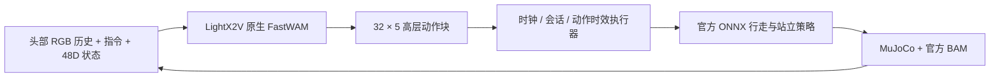

# LightX2V × MicroDuck：FastWAM 推理与仿真交接

给希望复现、分析和优化 **FastWAM 在 MicroDuck 上的视觉寻球决策** 的开发者。模型接收头部相机历史、指令和自身状态，输出移动、转头、停止命令；官方 ONNX 策略继续负责 50Hz 行走和平衡。

**本仓库交接已训练模型的推理与仿真代码，不启动新训练。部署权重由 [lightx2v/microduck](https://huggingface.co/lightx2v/microduck) 分发，不放入 Git。** 所有能力证据来自仿真开发集，尚未完成独立正式验收或真机验证。



## 从哪里开始

0. **[MicroDuck Studio 可视化服务](docs/microduck/visualization.md)**：全新独立页面，观看成功/失败录屏，按类别查看训练效果，并启动实时仿真。
1. [部署说明](docs/microduck/deployment.md)：独立 Docker、模型准备、固定输入测速、MuJoCo 闭环。
2. [优化交接](docs/microduck/optimization.md)：代码入口、加速开关、Profiler、数值与闭环回归。
3. [已实现能力与证据](docs/microduck/capabilities.md)：成绩对应的任务、部署和局限。
4. [权重清单](docs/microduck/weights.md)：大小、当前 H200 路径、必需与可省略文件。
5. [本次交接验证](docs/microduck/validation.md)：这个导出版本实际测试了什么。

## 当前可复现的能力

选定模型为 `clear-room-realtime-control-pilot-v1 / step 250`，指令限定红、蓝、黄球。通过观察、转向和行走寻找目标，接近后停止。它是任务后训练的高级控制策略，不直接输出关节角，不包含通用 VLM 规划器。

| 历史开发实验 | 结果 | 边界 |
|---|---:|---|
| 无障碍，7 布局 × 3 颜色，离线 | 19/21 | 开发成绩 |
| 新增 20 布局 × 3 颜色，实时，三项优化开启 | 59/60 | 单 H200，500ms 动作时效 |
| 同一实时批次，三项优化关闭 | 0/60 | 超时造成大量站立回退，不能解释为模型完全不会行动 |
| 未加速，关闭观测年龄拒绝，跨主机复测 | 17/60 | 部署与时效不同，不能作为上一行的严格单变量对照 |
| 单静态障碍，原动作范围，离线复核 | 27/60 | 未达标，失败也保留 |

数字来自[历史证据](docs/microduck/evidence/manifest.json)。本导出包含后续执行器修正，**新环境需要重新评测，历史分数不是当前提交的验收分数**。暂不声称掌握任意物体导航、可靠随机障碍、闭环定向踢球或真机自主行动。

## 部署概览

只想先看看训练效果？Python 3.10+ 即可启动录屏展厅，无需 GPU 或权重：

```bash
python3 scripts/microduck/fastwam_visualization.py --port 8770
# 打开 http://127.0.0.1:8770/
```

完整 GPU 实时仿真见[可视化部署说明](docs/microduck/visualization.md)。

Linux x86_64、Docker、NVIDIA Container Toolkit，当前验证硬件为单张 H200。先构建镜像，再按部署文档准备模型；未验证 24GB 显存卡。

```bash
git clone https://github.com/fuheaven/LightX2V-microduck.git
cd LightX2V-microduck
docker build -f deploy/microduck/fastwam/Dockerfile -t lightx2v-microduck:fastwam-v1 .
export FASTWAM_DATA=/absolute/path/to/microduck-data
export GPU_ID=0
GPU_ID=none deploy/microduck/fastwam/run.sh python scripts/microduck/fastwam_handoff.py fetch
# fetch 自动获取固定版本的模型、归一化、骨干组件和官方仿真资产。
GPU_ID=none deploy/microduck/fastwam/run.sh python scripts/microduck/fastwam_handoff.py verify
```

[下一步：运行测速和闭环](docs/microduck/deployment.md)。无需训练数据、TinyVLA、ROS2 或项目负责人机器上的 Web 服务。

## 代码和来源

- `lightx2v/`：原生 FastWAM、UMT5/VAE 与 LightX2V 推理实现。
- `embodied/microduck/src/lightx2v_microduck/`：独立仿真、控制契约、历史输入、执行器和评测；保留共享模块以满足依赖闭包。
- `scripts/microduck/fastwam_handoff.py`：本交接的部署/测速入口。
- `deploy/microduck/fastwam/`：Docker、运行依赖和模型文件锁。
- `docs/microduck/`：部署、能力、优化与证据。

基于 [ModelTC/LightX2V](https://github.com/ModelTC/LightX2V) 的固定源码快照，保留上游依赖，避免要求另一个浮动 checkout。参见 [source-provenance.json](docs/microduck/source-provenance.json) 和[上游 README](docs/microduck/UPSTREAM_README.md)。历史 TinyVLA、ROS 与训练模块的存在不表示此部署需要它们。

代码保留 Apache-2.0 及原文件声明；官方机器人资产有独立许可，由脚本从固定上游获取，不随此仓库重新打包。见 [THIRD_PARTY.md](docs/microduck/THIRD_PARTY.md)。
