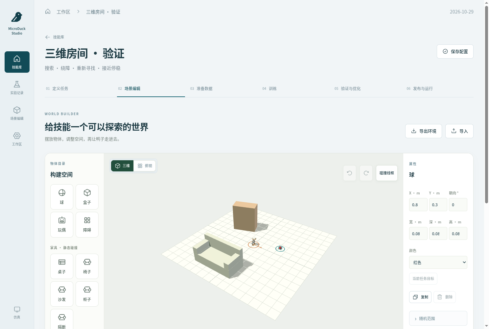
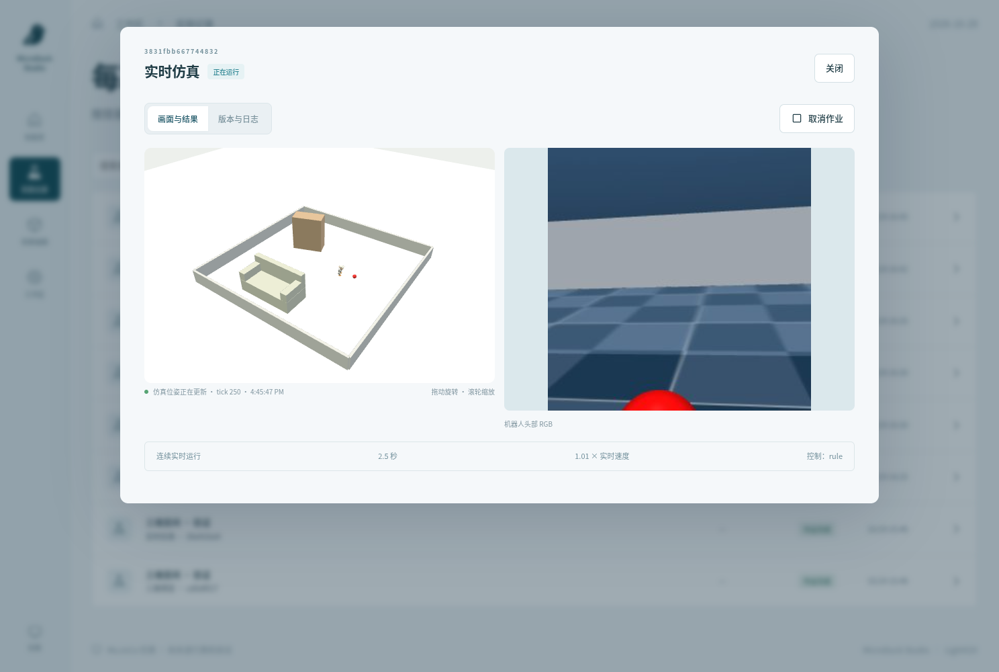

# Studio 三维环境与视频实验室

入口为独立 Studio（默认 `8771`），旧展厅与训练监控不变。本模块在现有 React/FastAPI 和独立运行器上增加场景创作、官方本体位姿显示、环境包、布局草案和离线视频审核。实现独立编写，没有复制许可不明确的 chrona / chrona-space 代码。

## 使用流程

1. 打开一个技能的「场景编辑」。左侧添加目标和家具，中央拖动位置，右侧设置朝向、尺寸、材质和随机范围。支持三维/俯视、撤销/恢复、复制/删除、碰撞线框。
2. 点击「保存场景」校验边界、重叠、出生区域、目标歧义和通路。点击「MuJoCo 运行预览」编译官方本体；实时运行仍在「发布与运行」选择策略。头部 RGB 保留原始 MuJoCo 画面。
3. 「导出环境」得到带校验摘要的 JSON，可在另一个工作区导入。不包含权重、训练数据或技能达标声明。
4. 配置布局模型后，输入自然语言生成草案。在三维画布预览，点击「应用布局」才修改技能；期间场景被编辑则拒绝应用旧草案。已提交作业始终使用冻结场景。
5. 完成一次仿真后，在运行详情的「VIDEO LAB」选择头部/观察者片段并生成增强录像。生成后同步播放原始采样帧与结果、逐帧检查、记录问题区间，分别审核五项一致性。

房间范围 2–6 米，单层平地，家具静态。目标仍是球、盒子和玩偶；桌椅等家具不扩大模型的识别能力。没有引入浏览器物理引擎、外部 GLB 或增强视频实时控制。





## 权威数据与兼容规则

- 场景坐标：米、Z-up、yaw 为度。新编辑保存 v2；v1 默认字段序列化不增加版本/家具字段，已保存实验快照不会迁移或重算哈希。
- 官方鸭子来自编译后的 MuJoCo 模型：直接导出 mesh 顶点、索引、可视 geom 和材质颜色，按 geom ID/名称绑定 `geom_xpos` / `geom_xmat`。没有重新建一个近似鸭子。
- 五类家具的部件尺寸和位置由 Three.js 与 MuJoCo 共用。教师使用这些碰撞体的保守 XY 投影（包括桌面），因此不规划从家具下方穿过的路线。
- 浏览器相机、网格线、选择框和光照仅供观察。学生输入仍是 MuJoCo 头部 RGB、8×8 ToF 和自身状态。三维状态接口不进入 SDK/VLM 的运行反馈。
- `GET /api/runs/{id}/visual` 提供可视清单；`GET /api/runs/{id}/state-stream` 用 SSE 推送 episode、tick、仿真时间、墙钟时间、geom 位姿和相机参数。断线冻结最后画面并显示时间；重连读取当前状态，结束事件关闭流。
- 新运行保留 `visual.json`、`state.json`、`poses.jsonl.gz`、`head.mp4`、`observer.mp4` 和历史兼容的 `recording.mp4`。录像按 10Hz 观测记录。旧实验没有位姿时继续显示原始记录，不伪造三维轨迹。
- 环境与资产摘要进入作业、数据集、评测 episode 和技能包。新环境需要新评测，不能继承旧场景成绩。

## 部署与配置

基础步骤见 [Studio 部署](studio.md)。需要 Docker Compose v2 / BuildKit，以使用各镜像的 `Dockerfile.dockerignore`；旧 classic builder 不支持该构建上下文规则。更新后重建 Web/运行器，并在空闲时重启两者。所有工作区只允许一个 Web 进程持有 SQLite WAL 连接；运行器与 Web 的代码摘要必须相同。

```bash
docker compose --env-file artifacts/studio.env -f deploy/microduck/studio/compose.yaml build web cpu
docker compose --env-file artifacts/studio.env -f deploy/microduck/studio/compose.yaml up -d web cpu
```

CPU 运行器准备 `assets/robot.json`。缺少官方资产或运行器代码不匹配时，编辑器显示原因及出生点标记；不会以近似模型替代官方鸭子。浏览器需要 WebGL2。首次载入官方网格会有下载时间；可视清单使用 gzip。

### 自然语言布局（可选）

在服务器环境中配置，URL 为 OpenAI-compatible **基础 URL（通常以 `/v1` 结尾）**：

```dotenv
STUDIO_SCENE_LLM_URL=https://your-model-server.example/v1
STUDIO_SCENE_LLM_MODEL=your-vision-or-language-model
STUDIO_SCENE_LLM_KEY=configure-locally
```

URL/model 同时传给 Web 和 CPU 运行器，key 只传运行器；不要提交凭据。模型必须支持 JSON-object 响应。返回数据受 `SceneChanges` / `SceneSpec` 约束，额外字段、未登记资产、越界、重叠和不可通行草案会被拒绝。没有配置时仅停用语言入口。

### H3 Ref2VA 视频运行器（可选）

这是 **Diffusers 参考实现**，未使用 LightX2V 视频加速。依赖与仿真/训练镜像隔离：`Video.Dockerfile` 固定 PyTorch 2.8.0 CUDA 12.8 基础镜像 digest；`video.in` 是输入，`video.lock` 固定完整解析依赖；Diffusers 固定 `d42ebf9c6e0b46103b74283f5324357a67acaa04`。镜像内 `/installed-packages.txt` 保存实际安装结果。

准备完整的本地 MiniMax-H3 Diffusers 快照（含 `modular_model_index.json`、`transformer_ref` 与所需编码器/VAE），放在 `${STUDIO_DATA_DIR}/models/MiniMax-H3`。模型许可证、来源和下载由部署者核对；不会自动下载大模型。为本地快照建立校验清单：

```bash
PYTHONPATH=embodied/microduck/src python scripts/microduck/studio_pin_video_model.py \
  --model /absolute/data/models/MiniMax-H3 --revision FULL_40_CHARACTER_UPSTREAM_COMMIT
```

配置 `STUDIO_VIDEO_GPU_ID` 为明确分配的单张 GPU。`STUDIO_H3_MIN_FREE_GIB` 默认 100，仅为可调整的启动检查门槛，**不是实测最低显存要求或 H200 可运行保证**。

```bash
docker compose --env-file artifacts/studio.env -f deploy/microduck/studio/compose.yaml \
  --profile video build video
docker compose --env-file artifacts/studio.env -f deploy/microduck/studio/compose.yaml \
  --profile video up -d video
```

分机部署时设置 `STUDIO_SERVER`，两机使用同一工作区挂载、相同代码和 worker token。GPU 运行器需要暴露恰好一张 GPU，登记 CUDA UUID；中央分配记录和继承给子进程的共享目录 `flock` 防止训练与视频作业并用同一卡。此机制管理同工作区 Studio 作业，不能抢占其它程序；仍须分配可用 GPU。运行器失联会终止子作业，过期任务不自动重启。

H3 输入片段为 5–15 秒。实现使用固定 24fps、`17*n+5` 的合法帧数（最近合法值，范围 124–345 帧），保存逐帧原始时间/帧号映射。图像等比例补边到指定画布。实际视频帧数、尺寸、帧率与真实 denoiser 调用次数必须匹配，否则生成失败。采样种子和实际耗时进入报告。

原始文件只读；生成文件带可见 `AI GENERATED` 标记。导出 ZIP 包含增强 MP4、源录像哈希、参数、时间映射及审核历史。结果不会进入训练目录、改变任务分数或用于在线控制。Ref2VA 可能利用未来参考帧，视觉审核不能证明传感器一致性。

## 验证与证据

```bash
PYTHONPATH=embodied/microduck/src python -m pytest \
  embodied/microduck/tests/test_studio.py embodied/microduck/tests/test_studio_world.py

# 有完整 MuJoCo/BAM 依赖和官方资产的 CPU 运行器内执行：
PYTHONPATH=embodied/microduck/src:third_party/bam python scripts/microduck/studio_world_smoke.py \
  --assets /absolute/data/upstream --out /absolute/workspace/world-smoke
```

冒烟脚本比较启用/关闭观察者导出的固定动作轨迹、检查家具位姿，并采集三个近目标停稳案例验证传感器记录与训练 loader。它不代替导航教师验收或学生测试。教师仍需每难度组 100 条、95%，学生仍需独立 200 条、80%；本次实现没有自动启动正式训练。

分阶段实际验证结果见 [三维平台验证记录](studio-world-validation.md)。无真实 H3 生成结果时，第三阶段保持未验收；配置入口存在不等于生成能力已经验证。
