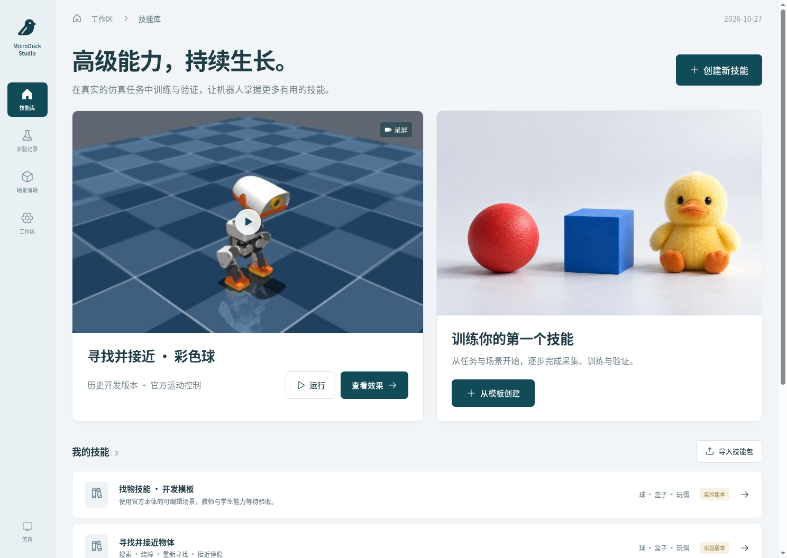

# MicroDuck Studio：高级技能工作室

这是新的 React / TypeScript 产品入口，默认端口 **8771**。页面、导航、场景编辑和工作区后端均重新实现。旧的 8770 录屏展厅和 8768 历史监控独立保留。

首页展示真实历史录像与技能模板。自定义技能按照「定义任务 → 场景 → 数据 → 训练 → 验证 → 发布」组织，实验以列表、筛选与详情展示。模板插画是示意图，录像来自原始证据包。



## 能做什么，以及证据边界

- 拖动、复制、删除、旋转和缩放场景物体，设置出生点与随机范围；保存时检查重叠、目标歧义及可通行性；三维预览使用官方 MuJoCo + BAM 本体。
- 运行教师检查和采集，在页面查看真实画面、失败、数据覆盖及训练曲线。
- 选择 FastWAM 或 ResNet18 + GRU，提交一次有上限的监督训练；周期性闭环验证选择候选，支持保存与显式恢复。
- 用冻结案例比较策略或 LightX2V 加速开关；分别报告离线和连续运行结果。
- 本地发布、导出模型技能包、在另一工作区导入，通过 SDK 或 VLM 工具接口调用。
- 已发布的 48D 历史 FastWAM 可以单独运行，仍使用原来的球任务与依赖校验。

**平台功能测试、单步模型验证和技能验收是不同交付。** 新的物体任务、176D 模型和几何教师尚不能继承历史寻球成绩。教师每难度组至少 100 集、95% 成功才能开放采集；学生正式测试至少 200 个不同条件、成功率 ≥80%。实时验收另检查 0.9–1.1 倍运行速度。全部保持 `hardware_validated=false`。

首版的球、盒子、玩偶是登记的程序化几何实例；测试采用独立尺寸区间和布局。它不代表自然物体开放类别识别，真实物体网格和纹理可通过任务插件扩展。

## Docker 部署

要求 Linux、Docker Compose v2 和足够磁盘空间；GPU 运行器需要 NVIDIA Container Toolkit。Web 可以不安装 CUDA。建议先启动 Web 与 CPU 预览，再配置 GPU。

```bash
git clone https://github.com/fuheaven/LightX2V-microduck.git
cd LightX2V-microduck
python3 deploy/microduck/studio/prepare.py \
  --workspace /absolute/path/to/studio-workspace \
  --data /absolute/path/to/microduck-data \
  --env-file artifacts/studio.env

docker compose --env-file artifacts/studio.env \
  -f deploy/microduck/studio/compose.yaml build

# 下载并逐项校验官方本体和 ONNX 策略。
docker compose --env-file artifacts/studio.env \
  -f deploy/microduck/studio/compose.yaml run --rm cpu \
  python scripts/microduck/fastwam_handoff.py fetch --data /data --component sim

docker compose --env-file artifacts/studio.env \
  -f deploy/microduck/studio/compose.yaml up -d web cpu
```

打开 `http://127.0.0.1:8771/`，输入 `artifacts/studio.env` 中的 `STUDIO_TOKEN`。令牌不进入 Git、模型包或作业快照。需要局域网访问时，在此环境文件中设置 `STUDIO_BIND=0.0.0.0`；工作区访问令牌和运行器令牌是两个不同的值。

工作区目录和数据目录由 `prepare.py` 创建，并记录当前用户 UID/GID。每个进程均以该用户运行。`data/cache`、`data/tmp` 和模型下载留在挂载目录；SQLite 和作业状态在工作区。可以复用已有经过校验的 `microduck-data`，无需复制训练历史或整个旧项目目录。

FastWAM 所需文件仍由 [固定 HF 发布清单](../../deploy/microduck/fastwam/model-files.lock.json) 管理，包含任务权重、归一化、T5、VAE、tokenizer 与配置，共约 26.24 GB：

```bash
docker compose --env-file artifacts/studio.env \
  -f deploy/microduck/studio/compose.yaml run --rm cpu \
  python scripts/microduck/fastwam_handoff.py fetch --data /data --component all

# 在环境文件里设置明确可用的 STUDIO_GPU_ID，默认只有一个 GPU worker。
docker compose --env-file artifacts/studio.env \
  -f deploy/microduck/studio/compose.yaml --profile gpu up -d gpu
```

轻量后端首次训练通过 torchvision 下载 ImageNet ResNet18 权重，缓存至 `/data/cache/torch`。网络受限时可预先运行 `torchvision.models.resnet18(weights='IMAGENET1K_V1')` 填充同一缓存。已训练的轻量技能包包含整个编码器，部署时不再下载预训练权重。

基础 GPU 镜像按 digest 固定；Python 和前端直接依赖分别固定在 `.lock`、`package-lock.json`。镜像内 `/installed-packages.txt` 记录完整实际依赖。交付给其他机器时，记录 `docker image inspect` 的 image ID；生产部署可将 `STUDIO_WORKER_IMAGE` 指向团队镜像仓库的 immutable digest，并同步 Web 与 worker 配置。

### Web / GPU 分机

本版采用**共享制品目录**：两台机器将同一 NFS/共享存储目录挂到容器 `/workspace-artifacts`；只有 Web 进程访问 SQLite，worker 通过 HTTP 领取任务。GPU 主机的模型目录可独立存放。

在 GPU 主机使用相同代码和镜像，设置：

```text
STUDIO_SERVER=http://WEB_HOST:8771
STUDIO_WORKSPACE_DIR=/mount/of/the/same/studio-workspace
STUDIO_DATA_DIR=/local/or/shared/microduck-data
STUDIO_WORKER_TOKEN=<与 Web 配置相同>
STUDIO_WORKER_IMAGE=<与 Web 配置相同>
STUDIO_GPU_ID=<明确分配的卡>
```

只启动 `gpu` 服务，不启动第二个 Web。目录内容不共享时不能只配置一个 HTTP 地址就开始训练；此版本没有隐藏的 SSH 文件同步。不要让两个 Web 实例同时管理同一数据库。

单 Web 进程持有长期 WAL 连接并串行管理短事务，避免每次心跳关闭连接时强制检查点；worker 领取、心跳及大文件校验在线程池处理。`/api/health` 显示 SQLite 版本；直接使用 Python 环境时请采用已修复的版本，服务会拒绝已知存在 Unix 锁死问题的 3.51.0/3.51.1。Linux 上可向 Web 主进程发送 `SIGUSR1`，把线程栈写入日志，辅助定位无法响应的问题。

### 运行与恢复

作业先保存任务、场景、种子、配方、来源文件摘要和模型版本。运行器按顺序领取匹配的源码/镜像任务，一个 GPU worker 同时执行一个任务。没有匹配运行器时页面保持排队。

提交前可调整最大训练步数和运行时限；单轮流水线的运行时限覆盖教师、采集、训练和评测的总时间，不是累计 GPU 用量限制。到时停止并保存已有记录，不自动追加轮次。

取消会设置停止标记、清空动作缓冲并保存可恢复训练状态。服务中断后不会自动重启训练：失去租约的作业标记为中断，待用户显式恢复。恢复检查数据、统计、配方和任务没有改变。更改这些条件应提交新一轮。

```bash
docker compose --env-file artifacts/studio.env -f deploy/microduck/studio/compose.yaml logs -f web cpu
docker compose --env-file artifacts/studio.env -f deploy/microduck/studio/compose.yaml stop
```

CPU 软件渲染可能慢于真实时间，页面显示实测运行倍率。GPU 渲染使用 EGL；实时物理循环不等待模型推理，但渲染和物理本身的耗时仍必须测量，不能仅以帧在变化宣称 50Hz 达标。

## 训练和评测契约

学生输入为四帧 RGB 历史（6/3/1/0 秒）、48D 自身状态、64D ToF 距离和 64D 有效掩码。ToF 数值、状态和时间戳真实记录，缺传感器立即失败；不静默补零。数据存储的教师真值与学生张量分开。

- `FastWAM`：从发布的 48D MicroDuck 模型初始化，**显式扩展并重训**状态编码为 176D。视频、文本、VAE 冻结；训练动作和状态侧。默认 BF16、AdamW、3e-6、有效 batch 8、1,000 步，每 250 步闭环验证。
- `轻量策略`：ImageNet ResNet18、状态编码、类别/颜色条件和 GRU256，输出相同 `32×5` 动作；连续动作 Huber、停止通道 BCE。默认 lr 1e-4、batch 64、5,000 步。
- 两者都通过官方 ONNX 输出实际关节控制。没有重新训练官方 RL，也没有引入 TorchRL。

教师检查先验证每个难度组。正式采集按组/类别/颜色平衡补足合格示范，失败轨迹保留；最多尝试固定的候选池，不无限采集。80/10/10 集合具有不同布局、几何实例尺寸区间与真实语言模板。只用训练集拟合归一化。

本轮流程不会自动添加 DAgger 迭代；键盘纠错是用户发起的独立运行，保存学生状态、实际操作、控制来源与录像，**不会把人工接管计为模型成功或自动混入合格数据**。自动克隆学生状态、生成教师分支标签和聚合纠偏数据可通过后续插件扩展。

每次评测先保存案例清单，再执行同一任务判定：接近目标表面 0.25–0.40m 并稳定至少 2 秒；碰撞、跌倒、超时、接管均失败。场景、执行时限或权重不同不能当成严格加速对照。正式测试不得参与模型选择。

LightX2V 对照包含 prompt cache、action context cache、CUDA Graph；一步蒸馏尚未接入。每份报告保留真实成功率、Wilson 置信区间、推理延迟、运行倍率及资源量。VLM 的费用缺少单价时显示未知，不按免费处理。仅凭本轮测试不能得出 WAM 优于所有 VLM 的结论。

## 技能发布与工具调用

发布时模型、统计量和模型清单均做 SHA256 校验；技能版本固定对应任务合同。发布实验候选是允许的，只有与对应权重绑定的独立测试达标，才标记离线或实时已验收。

在「验证与优化」完成正式测试后，通过版本的「登记验收」操作创建新的验收版本。后端重新核对权重、任务、案例清单和评测门槛，原实验版本保持不变；作业退出成功不会自动改变技能状态。

```python
from lightx2v_microduck.studio.sdk import Studio, TOOLS

client = Studio("http://127.0.0.1:8771", token="YOUR_WORKSPACE_TOKEN")
job = client.run("SKILL_ID", "VERSION_ID", backend="lightweight", category="box", color="blue")
status = client.status(job["run_id"])
client.cancel(job["run_id"])
client.close()
```

`TOOLS` 是 VLM 函数定义；参考 [工具分发示例](../../examples/microduck/studio/vlm_tools.py)。工具查询返回执行状态和策略反馈，隐藏评测成功答案、目标坐标和世界真值。此版本提供工具调用接口，没有默认开启付费云模型或完整对话规划器。

导出包包含冻结任务、权重、统计量、模型契约、来源和报告；不包含完整数据、缓存、优化器与全部 checkpoint。FastWAM 普通包固定引用共享骨干；`GET /api/versions/{id}/export?offline=true` 将校验过的骨干一起打包。导入到另一工作区后先标为实验，重新验证后再授予当地验收状态。

## Python 任务扩展

实现 `environment(scene, task, **kwargs)`、`teacher(env)`、`score(env, interventions)`，通过 `microduck.studio.tasks` entry point 注册。任务插件只在 worker 加载；网页不会接受可执行 Python 源码。示例位于 [task_plugin](../../examples/microduck/studio/task_plugin)。

当前导航动作接口保持 `microduck_navigation_v1`。新增踢球、头部控制等动作接口必须有新版本、执行器和独立任务测试，不能重新解释已有模型的五个输出。

代码入口：`studio/schema.py`（合同）、`store.py`（队列）、`scene.py`（场景）、`simulation.py`（实机契约仿真）、`dataset.py`（数据审计）、`training.py`（双后端）、`api.py` / `worker.py`（分机）、`packages.py`（导入导出）。

测试与已完成的验证见 [Studio 验证记录](studio-validation.md)。
