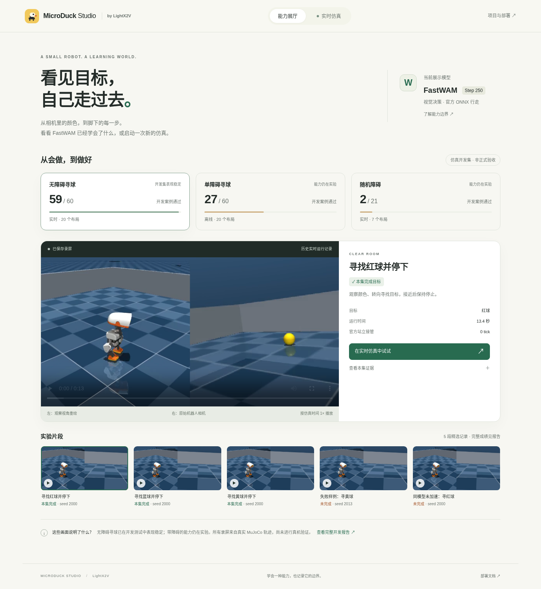

# MicroDuck Studio：独立可视化服务

新服务使用独立页面、入口和端口，展示已经记录的训练效果，并允许用户启动新的 MuJoCo 实时仿真。它不依赖原训练监控服务、ROS2、个人机器上的历史工件目录或第三方前端 CDN，也不会启动训练。



页面有两个入口：

- **能力展厅**：按无障碍、单障碍、随机障碍分类；展示完整开发集成绩、9 段精选录屏和对应的原始报告。成功和失败分开标注。
- **实时仿真**：选择 FastWAM 寻球或官方 ONNX 行走演示，开始后观察新运行的第三人称画面。FastWAM 同时显示实际头部相机、推理耗时、控制来源、站立接管次数和仿真/实际时间比；支持停止。

## 1. 只看能力与录屏：无需 GPU、权重或安装 Python 依赖

Python 3.10+，在 Linux 或 macOS 中：

```bash
git clone https://github.com/fuheaven/LightX2V-microduck.git
cd LightX2V-microduck
python3 scripts/microduck/fastwam_visualization.py --port 8770
```

打开 **http://127.0.0.1:8770/**。媒体和报告随 Git 分发，约 12MB，不需要连接原来的 8768 训练监控页面。初次启动会核验媒体 SHA256；视频支持 HTTP Range，可拖动播放进度。

此模式下实时运行按钮不可用，页面说明缺少的运行器。它不会播放录屏来冒充实时仿真。

如果在服务器运行，需要让同组成员通过局域网访问：

```bash
python3 scripts/microduck/fastwam_visualization.py --host 0.0.0.0 --port 8770
```

访问 `http://服务器IP:8770/`。`localhost` 始终是浏览器所在机器；同事访问远端服务器时应使用服务器 IP。

## 2. 完整实时仿真：同一台 GPU 服务器部署

复用[原生 FastWAM 部署环境](deployment.md)，但由独立 Web 进程提供入口。当前验证硬件是 H200；没有宣称普通笔记本或 24GB 显卡能运行本模型。

```bash
docker build -f deploy/microduck/fastwam/Dockerfile \
  -t lightx2v-microduck:fastwam-v1 .

export FASTWAM_DATA=/absolute/path/to/microduck-data
export GPU_ID=0                    # 指定一张可用 GPU

# 获取固定版本的官方本体、ONNX 和公开骨干：
GPU_ID=none deploy/microduck/fastwam/run.sh \
  python scripts/microduck/fastwam_handoff.py fetch --component all
```

从负责人处取得已训练工件，按[权重部署说明](deployment.md)放入：

```text
$FASTWAM_DATA/
  models/
    microduck/
      model.pt
      dataset_stats.json
      navigation_checkpoint.json
    Wan2.2-TI2V-5B/          # 最小骨干文件，fetch 已获取
  upstream/
    microduck_rl/
    microduck-policies/
```

权重约 12.04GB，包含骨干的最小部署总文件量约 26.24GB；权重没有上传到本仓库。

启动：

```bash
# 默认只在本机暴露 127.0.0.1:8770。
deploy/microduck/fastwam/web.sh

# 或向局域网开放固定端口：
WEB_BIND=0.0.0.0 WEB_PORT=8770 deploy/microduck/fastwam/web.sh
```

这就是独立的一机部署：浏览器 → Web → 仿真/模型子进程，不需要 SSH 转发。默认容器名 `microduck-studio`，可通过 `FASTWAM_WEB_NAME` 修改；停止整个服务使用 `docker stop microduck-studio`。服务日志用 `docker logs -f microduck-studio`。

需要服务随用户会话自动恢复时，可按 `deploy/microduck/fastwam/microduck-studio.service.example` 安装为 systemd 用户服务：修改其中的仓库路径，并在 `~/.config/microduck-studio.env` 写入 `FASTWAM_DATA=/absolute/path`、`GPU_ID=0`、`WEB_BIND=0.0.0.0`、`WEB_PORT=8770`。将模板复制为 `~/.config/systemd/user/microduck-studio.service` 后执行 `systemctl --user daemon-reload` 和 `systemctl --user enable --now microduck-studio.service`。若修改容器名，同步修改模板的 `ExecStop`。

页面保持运行时**不加载模型**；点击开始后依次校验约 26GB 文件、加载模型、预热相机和推理，然后启动任务时钟。每次新会话可能需要数分钟准备，取决于存储和 GPU。结束/停止后子进程退出，释放 GPU 内存。当前版本用这种方式保证会话隔离和空闲释放；优化模型常驻/切换开销是后续工作。

没有 FastWAM 权重时，也可先检查官方 ONNX 的实时运动和画面：

```bash
GPU_ID=none deploy/microduck/fastwam/run.sh \
  python scripts/microduck/fastwam_handoff.py fetch --component sim
GPU_ID=none WEB_PORT=8770 deploy/microduck/fastwam/web.sh
```

CPU 模式使用 OSMesa，提供官方行走演示，不执行 FastWAM 视觉寻球。官方演示最多运行到任务自身的结束时刻，因此可能早于所选最长时长结束。

## 3. 实时运行的含义和结果

FastWAM 采用相同的训练输入和执行契约：4 张真实相机历史 → 512×512 历史网格，语言和 48 维自身状态；输出 32×5 高层动作，由官方 ONNX 负责 50Hz 行走/站立。500ms 过期拒绝、站立回退、会话隔离和原有任务判定均保留。

浏览器约每 350ms 获取最新状态；观察视角目标 5fps，在独立线程中渲染 **`mj_copyData` 的物理快照**。渲染器忙时丢弃展示帧，不等待浏览器，不用展示画面替换模型输入。模型推理仍是独立工作线程，物理不等待推理。

默认使用 OSMesa + 4 个后台头部相机快照工作线程，保留 256×256、原 MSAA 和真实采集时间。头部预览来自真实传感器观测；模型按历史契约选取输入，忙时不保证消费每一张展示帧。此配置避免已复现的 H200 / 580.95.05 驱动在 CUDA 与 EGL 并用时取图卡顿；未修改共享主机驱动。OSMesa 和历史 EGL 不是同一渲染后端，因此新演示记录自己的执行结果，不继承历史分数。

页面的“仿真 / 实际时间”接近 1× 才意味着接近实时。额外观察视角会消耗资源，具体平台可能降速；结果如实记录。实时成功要求任务成功、无接管，且原评测器的时钟门槛通过，不能仅凭画面正在更新就算通过。

- **开始**：创建新的独立进程、场景和模型会话，当前仅允许一个运行。
- **停止**：请求清空并结束本次运行；准备或推理卡住时在宽限期后终止整个子进程组，释放资源。已取消运行不计成功。
- **关闭/刷新网页**：不会暂停物理。重新打开可恢复查看当前运行；任务到达最长时长或自身结束条件后退出。
- **服务重启**：旧记录标为中断，不自动恢复或重复执行。
- **异常卡住**：每次运行有 10 分钟墙钟上限，超过后终止并记录失败，不自动重试。
- **运行结束**：显示最后一帧和本次结果，不把它标为持续实时画面。

数据写入 `$FASTWAM_DATA/results/visualization/<run_id>/`：

| 文件 | 内容 |
|---|---|
| `request.json`、`job.json` | 用户配置、进程状态与开始/结束时间 |
| `live.json`、`observer.jpg`、`camera.jpg` | 最新展示帧及其原始 tick/采集与发布时间 |
| `worker.log` | 子进程诊断 |
| `resolved_config.json` | FastWAM 实际配置 |
| `episode/` | FastWAM 原评测报告、控制轨迹、录制观测和预测 |
| `outcome.json` | 本次 UI 结果；明确 `formal_acceptance=false` |

“LightX2V 加速”开启 prompt cache、action context cache 和 action CUDA Graph；“未加速对照”关闭这三项。两者保持同一模型、20 步采样及动作契约。展示运行有额外渲染开销，严谨性能比较仍使用[无界面的测速命令](optimization.md)。

## 4. 可选：展示服务与 GPU 运行器分开

例如前端服务器固定 IP，模型放在另一台 GPU 机器：在 GPU 机器按第 2 节启动服务，然后在展示服务器启动：

```bash
python3 scripts/microduck/fastwam_visualization.py \
  --host 0.0.0.0 --port 8770 \
  --worker-url http://GPU服务器可达地址:8770
```

浏览器只访问展示服务器。所有实时请求和帧经同源 API 转发；模型文件留在 GPU 机器。GPU 运行器不可达时，录屏仍可查看，实时入口会提示离线。

网络只允许 SSH 的情况下，可在展示服务器单独建立转发，再使用 `--worker-url http://127.0.0.1:18770`。转发属于部署网络配置，不是运行本项目的必要依赖；密钥、密码不写入仓库。

服务面向可信内网开发者，没有用户账号与访问鉴权。默认监听回环地址；如需公网访问，应放在已有鉴权网关后面。

## 5. 检查、故障定位与代码入口

```bash
curl http://127.0.0.1:8770/api/health
curl http://127.0.0.1:8770/api/live
```

- 录屏 checksum 错误：确认 Git 中示例文件完整，不要用未登记的视频覆盖同名文件。
- 找不到模型：检查 `FASTWAM_DATA` 和 3 个 MicroDuck 工件；服务拒绝静默切换为官方策略。
- 默认让 H200 只负责推理、OSMesa 负责后台渲染。经验证没有上述驱动问题的平台可显式使用 `MUJOCO_GL=egl .../web.sh`；运行器选择随仓库提供的 NVIDIA EGL vendor 描述，避免 CUDA 镜像缺少 vendor JSON 时悄悄退回 Mesa。`viewer.render_device` 记录实际设备。EGL 是可选配置，本次未通过 H200 的连续运行验证。`MUJOCO_GL` 和 `PYOPENGL_PLATFORM` 不要混用。
- 看到“完成任务，但实时门槛未通过”：查看 RTF、模型耗时、相机耗时和 `maximum_clock_lag_s`；这是速度问题，不应通过放宽成功条件隐藏。
- 部署文档的固定资产和模型锁针对当前保留模型；页面历史成绩不会因新运行成功而自动改写。

入口：

- `scripts/microduck/fastwam_visualization.py`：标准库服务入口。
- `embodied/microduck/src/lightx2v_microduck/visualization.py`：媒体校验、HTTP Range、运行管理和可选代理。
- `embodied/microduck/src/lightx2v_microduck/resources/visualization/`：独立 UI，不引用旧训练监控页面或样式。
- `scripts/microduck/fastwam_visual_worker.py`：模型校验、加载和单次仿真。
- `embodied/microduck/src/lightx2v_microduck/navigation_viewer.py`：不会阻塞物理的观察视角渲染。
- `examples/microduck/visualization/catalog.json`：可核验的媒体与证据目录。

测试与实测记录见 [visualization-validation.md](visualization-validation.md)。
